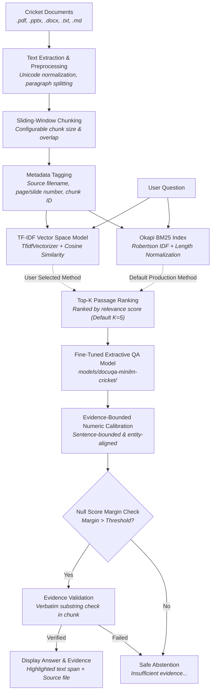
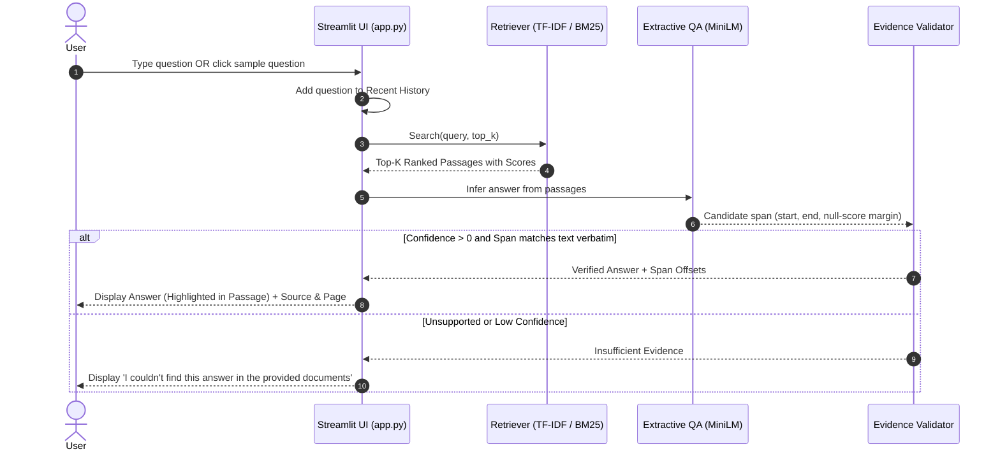
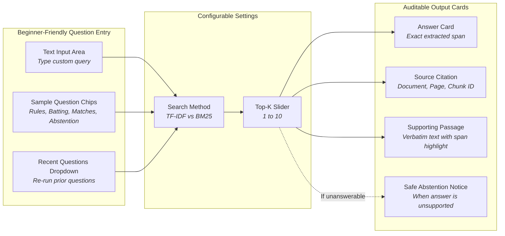

# DocuQA — Cricket Document-Grounded Question Answering

> **A local, extractive Question Answering (QA) and Information Retrieval (IR) system designed for cricket rulebooks, laws, and match guides.**  
> Built with TF-IDF, Okapi BM25, a local Hugging Face Transformer checkpoint, and a beginner-friendly Streamlit web application.

---

## Overview

DocuQA is a domain-specific document question-answering system. Given a collection of cricket documents (in PDF, PPTX, DOCX, TXT, or Markdown format), DocuQA indexes the text into overlapping word windows, retrieves candidate passages via classical IR algorithms (**TF-IDF with Cosine Similarity** or **Okapi BM25**), and uses a **local extractive Transformer** to pinpoint the exact answer span within the retrieved evidence.

### Core Principles
- **Evidence-constrained extractive answers:** Answers are selected as verbatim character spans from retrieved passages and checked against cited evidence; unsupported cases are designed to trigger abstention.
- **Auditable Evidence & Attribution:** Every answer cites its exact source document, PDF page or PowerPoint slide number (when available), chunk ID, and character offsets.
- **Safe Abstention:** If a question cannot be answered from the provided documents or if model confidence falls below threshold, DocuQA abstains with an explicit notice instead of guessing or fabricating facts.
- **Zero External APIs:** Runs completely offline on local CPU/GPU using PyTorch and Hugging Face Transformers. No OpenAI, Anthropic, or external cloud calls.
- **No Heavy Vector Databases:** Pure Information Retrieval (TF-IDF and BM25) without LangChain, Chroma, FAISS, or complex agent overhead.

---

## System Architecture



---

## Document-grounded question generation

For uploaded documents, the app offers an on-demand **Generate document Q&A** action. A local question-generation model (valhalla/t5-small-e2e-qg) proposes candidate questions from representative chunks in the active corpus. DocuQA then sends each candidate through the existing BM25 retriever and fine-tuned extractive MiniLM QA model.

Only Q&A pairs whose answer is marked supported and whose answer span matches the cited evidence exactly are displayed. Candidates that cannot be answered from the active corpus are discarded, not guessed. The question-generation checkpoint is downloaded from Hugging Face on first use; generation and answer inference run locally and do not call a hosted inference API. See the question-generation [model card](https://huggingface.co/valhalla/t5-small-e2e-qg).

## User Interaction Flow



---

## UI Component & State Flow



---

## Corpora Structure

DocuQA includes two distinct corpora for development, demonstration, and benchmarking:

| Directory | Purpose | Contents |
| :--- | :--- | :--- |
| **`data/documents/`**<br>*(Primary Knowledge Base)* | Curated, authoritative ground truth for cricket knowledge and the 37-question benchmark suite. | 8 comprehensive Markdown documents:<br>• `01_laws_and_rules.md`<br>• `02_batting.md`<br>• `03_bowling.md`<br>• `04_fielding.md`<br>• `05_scoring.md`<br>• `06_match_structure.md`<br>• `07_players_and_teams.md`<br>• `08_tournaments.md` |
| **`assests/`**<br>*(Official Regulatory Library)* | Complete official tournament & match conditions directly from ICC, MCC, and BCCI. | 18 complete PDF documents (~900 pages):<br>• `ICC_Mens_Test_Match_Playing_Conditions_2026.pdf`<br>• `ICC_Mens_ODI_Playing_Conditions_2026.pdf`<br>• `ICC_Mens_T20I_Playing_Conditions_2026.pdf`<br>• `ICC_Mens_T20_World_Cup_2026.pdf`<br>• `ICC_World_Test_Championship_2025_2027.pdf`<br>• `TATA_IPL_2026_Match_Playing_Conditions.pdf`<br>• `ICC_Womens_Test_Match_Playing_Conditions_2026.pdf`<br>• `ICC_Womens_ODI_Playing_Conditions_2026.pdf`<br>• `ICC_Womens_T20I_Playing_Conditions_2026.pdf`<br>• `Playing Conditions ICC Women's T20 World Cup 2026.pdf`<br>• `Laws-of-Cricket-2017-Code-4th-Edition-(2026)_5.pdf`<br>• `Ten-major-changes-to-Laws-for-2026-edition.pdf`<br>• `ICC_Code_of_Conduct_Players_Support_Personnel.pdf`<br>• `ICC_Anti_Doping_Code.pdf`<br>• `ICC_Minimum_Standards_PMOA.pdf`<br>• `ICC_T20I_Playing_Conditions_Addendum_2026.pdf`<br>• `cricket_tutorial.pdf`<br>• `toaz.info-cricket-projectpdf...pdf` |
| **`sample_corpus/`**<br>*(Multi-Format Test Suite)* | Used for verifying cross-format parser pipelines and multi-page document extraction. | 4 mixed-format files:<br>• `cricket_basics.md` (Markdown)<br>• `cricket_pages.pdf` (Multi-page PDF with page numbers)<br>• `cricket_pitch.txt` (Plain text)<br>• `cricket_rules.docx` (Microsoft Word Document) |

---

## Features

- **Beginner-Friendly Web UI:** Designed so that students, teachers, and non-technical evaluators can ask questions and verify answers within 10 seconds.
- **Clickable Sample Questions:** Categorized buttons under *Rules*, *Batting & Scoring*, *Matches & Teams*, and *Test a Question Without an Answer* for instant demonstration.
- **Session Question History:** Stores previous queries in *Recent Questions* to enable immediate re-running and retriever comparison.
- **Visual Answer Highlighting:** Highlights the exact extracted text span in yellow `<mark>` within the supporting document passage.
- **Dual Retrieval Engines:**
  - **TF-IDF + Cosine Similarity:** Fitted term-frequency / inverse-document-frequency matrix.
  - **Okapi BM25:** Pure Python implementation with Robertson IDF, term frequency saturation ($k_1 = 1.5$), and document length normalization ($b = 0.75$).
- **Reproducible Evaluation Benchmark:**
  - Evaluates both answerable and unanswerable questions from `data/evaluation/questions.json` (64 validated questions: 54 answerable, 10 unanswerable).
  - Calculates **Precision@K**, **Recall@K**, **MRR**, **MAP**, **NDCG@K**, **Exact Match (EM)**, **Token F1**, evidence/source validity, and abstention rates.
  - Provides a **Fast Retrieval-Only Mode** (runs in <1 second) and a **Full QA Benchmark Mode** with live progress tracking.

---

## Installation & Setup

### Prerequisites
- Python 3.11, 3.12, 3.13, or 3.14
- Git (optional)

### 1. Install Package in Editable Mode
From the root directory:
```powershell
python -m pip install -e .
```

### 2. Verify Installation with Pytest
```powershell
python -m pytest -q
```
*(Expected: `75 passed, 2 skipped`)*

---

## Running the Application

### Launch Streamlit Web UI

#### On Windows (Recommended):
Use the helper script to ensure the Windows asyncio event loop starts without pipe stalls:
```powershell
python scripts/run_streamlit.py run app.py
```

#### Standard Command:
```powershell
python -m streamlit run app.py
```

Open your browser at **`http://localhost:8501`**.

---

## Running Benchmarks (CLI)

You can run automated benchmarks over the 64 questions in `data/evaluation/questions.json`:

### Fast Retrieval Benchmark (TF-IDF vs BM25)
Computes IR ranking metrics across $K \in \{1, 3, 5, 10\}$ in under 2 seconds:
```powershell
python -m docuqa.benchmark --no-qa --output results
```
Outputs:
- `results/metrics_summary.csv`: Macro-averaged metrics by method and $K$.
- `results/per_question.json`: Detailed per-question ranks, scores, and retrieved passages.

### Full QA Benchmark (Retrieval + Transformer QA)
Evaluates retrieval metrics plus SQuAD-style Exact Match (EM) and Token F1:
```powershell
python -m docuqa.benchmark --output results-qa
```

### Phases 3–5: Fair Experiments, Full QA, and Final Analysis
Run both controlled retrieval experiments, the full QA benchmark, and generate
a Markdown report from the measured results:
```powershell
python -m docuqa.research --output results-phase3-5
```
Phase 3 compares Top-K values `{1, 3, 5, 10}` on the same 120-word/20-word-overlap
index and compares chunk sizes `{80, 100, 120, 160}` at fixed overlap 20 and
Top-K 3. Phase 4 evaluates both retrievers at Top-K 3 by default (Top-K 5 is
available via `--top-k 3 5`), including
Exact Match, Token F1, evidence span/source validity, and abstention correctness.
Phase 5 writes `final_report.json` and `final_report.md`; Phase 3 rows are saved
to `phase3_experiments.json`, and Phase 4 raw rows and metadata are saved under
`full_qa/`. Generating final reports writes separate `final_report.*` files and
does not overwrite the raw Phase 4 rows or CSV.
Use `--no-qa` to run Phases 3 and 5 without loading the local Transformer model.
The standard benchmark contains 64 questions (54 answerable and 10 designed to
test abstention). Exact Match uses consistent SQuAD normalization: lowercase,
remove punctuation and articles (`a`, `an`, `the`), then collapse whitespace.

---

## Project Structure

```text
DocuQA/
├── .github/
│   └── workflows/
│       └── ci.yml               # Automated CI testing matrix (Python 3.11–3.13)
├── .streamlit/
│   └── config.toml              # Streamlit server and layout configuration
├── data/
│   ├── documents/               # Primary Cricket Knowledge Base (8 Markdown files)
│   └── evaluation/
│       └── questions.json       # 64 curated evaluation questions (54 answerable, 10 unanswerable)
├── docuqa/                      # Core Python library
│   ├── __init__.py              # Package exports
│   ├── application.py           # Corpus indexing & search execution workflow
│   ├── benchmark.py             # CLI evaluation and metrics runner
│   ├── bm25.py                  # Okapi BM25 ranking algorithm
│   ├── config.py                # Environment configurations & corpus paths
│   ├── evaluation.py            # Evaluation metrics (P@K, R@K, MRR, MAP, NDCG, EM, F1)
│   ├── ingestion.py             # Multi-format document parsers & text chunker
│   ├── qa.py                    # Local extractive Transformer QA & validation logic
│   └── retrieval.py             # TF-IDF & cosine vector space model
├── sample_corpus/               # Multi-format test suite (MD, PDF, TXT, DOCX)
├── scripts/
│   ├── evaluate.py              # Standalone evaluation utility
│   └── run_streamlit.py         # Windows-compatible Streamlit launcher
├── tests/                       # Complete automated test suite (41 tests)
├── .gitignore                   # Ignore rules for pycache, caches, and logs
├── app.py                       # Main Streamlit web application
├── pyproject.toml               # Package build configuration & dependencies
├── README.md                    # Project documentation
└── requirements.txt             # Pip dependencies
```

---

## Methodology Reference

1. **Ingestion & Extraction:**
   - PDF extraction via `pypdf`, preserving 1-based page numbers.
   - PowerPoint extraction via `python-pptx`, preserving 1-based slide numbers and table cell text.
   - DOCX extraction via `python-docx`.
   - Markdown and TXT normalization (BOM removal, whitespace normalization, layout cleaning).
2. **Chunking:**
   - Sliding word-window chunking with configurable `chunk_size` (default: 120 words) and `overlap` (default: 20 words).
3. **Retrieval Engine:**
   - **Okapi BM25 (Default)**: Robertson IDF, $k_1 = 1.5, b = 0.75$, Default Top-K = 5.
   - **TF-IDF + Cosine Similarity**: Secondary baseline retriever.
4. **Extractive QA Model:**
   - Fine-tuned domain model checkpoint (`models/docuqa-minilm-cricket/`) based on MiniLM-L6-H384-uncased, trained on cricket QA pairs.
5. **Span Calibration:**
   - Sentence-bounded, entity-aligned numeric calibration (Variant D) to ensure precise count and unit selection (e.g., overs vs innings) without cross-sentence contamination.
6. **Evidence Validation & Abstention:**
   - Strictly enforces character-slice validity: `evidence_text[start:end] == answer` (100.0% evidence validity rate).
   - Unanswerable queries cleanly abstain with `"Insufficient evidence in the provided documents."` when confidence falls below margin threshold.

---

## Final Production Benchmark Performance

Evaluated against the fixed 64-question cricket benchmark (`data/evaluation/questions.json`):

| Metric Category | Metric | Final Production Result |
|:---|:---|:---:|
| **Overall QA Accuracy** | **Exact Match (EM)** | **0.7344** (47 / 64) |
| | **Token F1** | **0.9171** |
| **Answerable Subset (N=54)**| **Answerable EM** | **0.6852** (37 / 54) |
| | **Answerable Success** | **0.8333** (45 / 54) |
| | **Source Accuracy** | **0.9444** (51 / 54) |
| **Safety & Grounding** | **Evidence Validity Rate** | **1.0000** (100.0%) |
| | **Abstention Accuracy (Unanswerable N=10)** | **1.0000** (10 / 10) |
| | **Overall Abstention Correctness (N=64)** | **1.0000** (64 / 64) |
| **Information Retrieval (IR)**| **Recall@5** | **1.0000** (54 / 54) |
| | **Precision@5** | **0.3441** |
| | **Mean Reciprocal Rank (MRR)** | **0.9506** |
| | **Mean Average Precision (MAP)** | **0.3166** |
| | **NDCG@5** | **0.9634** |

---

## Technical Limitations

1. **Extractive Only:** Answers are exact character spans selected from retrieved passages; the system cannot perform multi-hop synthesis, abstractive summarization, or arithmetic across disjoint paragraphs.
2. **Span Boundary Sensitivity:** Human reference answers that omit leading function words or articles may produce Exact Match = 0.0 even when Token F1 exceeds 0.85.
3. **Lexical Dependence:** While BM25 provides strong keyword matching, queries with heavily paraphrased or colloquial expressions may retrieve lower-ranked passages compared to dense semantic embeddings.
4. **Cross-Chunk Boundary:** Evidence split across two adjacent chunks cannot be merged into a single extractive span.
5. **OCR Sensitivity:** For scanned PDF inputs, text extraction accuracy is dependent on the underlying PDF text stream or OCR quality.
